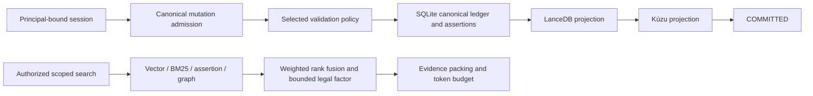

# MESA — Memory Engine for Structured Agents

MESA Core stores source-backed agent memory and retrieves scoped evidence over
HTTP, Python clients and MCP. SQLite owns the catalog, assertions, mutation
ledger and artifact ownership; LanceDB and Kùzu provide derived projections.

The checkout has package version **0.7.1**. **v0.8.0 is a release target, not a
published or certified release.** This development tree is a release candidate.
Production remains `NO-GO` until the
[required release gates](docs/release.md) pass on the intended release commit.
Check published versions in [GitHub Releases](https://github.com/Yasou13/MESA/releases).

## Getting started

Python 3.10–3.13 are the CI matrix; the project declares Python >=3.10.
Use the checked-in lockfile:

```bash
git clone https://github.com/Yasou13/MESA.git
cd MESA
uv sync --locked --extra dev
uv pip check
```

Follow the [disposable local quickstart](docs/getting-started.md) for credential
and ACL provisioning, scoped insert, terminal-state polling, retrieval and
restart. Model-disabled operation demonstrates V3 storage and lexical behavior;
it does not measure embedding quality or LLM extraction. Full provider setup
is in [installation](docs/installation.md) and [configuration](docs/configuration.md).

### Safe core Compose

Provision `MESA_API_KEY` and `MESA_PRINCIPAL_ID` through your reviewed secret
environment before starting the separate V3 API/worker topology:

```bash
docker compose config --quiet
docker compose up --build -d
curl --fail -H "X-API-Key: $MESA_API_KEY" http://localhost:8000/health
```

Compose sets `MESA_MODEL_ENABLED=false` and
`MESA_EXTERNAL_PROVIDER_ENABLED=false`. Create an authorized session through
`/v3/memory/session/start` before writing. For an already authorized
`analyst_1` record with returned log ID 1, the status URL pattern is
`/v3/memory/status/1?agent_id=analyst_1`; substitute your actual actor and log ID.
This example does not promise a download/build duration.

### Full cognitive runtime

V4 uses `docker-compose.v4.yml` with one combined owner, model-enabled canonical
processing, reviewed providers and matching embedding identity. Follow the
provider prerequisites in [installation](docs/installation.md); model-disabled
boot rejects V4 inserts with `503 canonical_processing_unavailable`.

## Architecture overview



V4 runs one `combined` storage owner per root. Sessions bind a principal,
tenant, workspace, agent and immutable dataset set. Validation is selectable:
deterministic-only (0), single LLM (1), or dual LLM consensus (2). Model consensus
does not prove source truth or legal correctness.

`FactExtractionService` owns canonical V4 extraction; REBEL is not part of
canonical V4 extraction.

### Legacy/V3 CPU-Only REBEL Extraction

REBEL is a legacy V3 opt-in using the ML extra. Its CPU cost and language/model
behavior require deployment-specific measurement; no current latency or model
quality result is claimed here.

Search combines four evidence lanes with weighted reciprocal rank fusion.
Graph neighbor retrieval is available when the configured provider is
operational. `GET /v4/capability` reports runtime availability. Context defaults
to one search; optional `adaptive` mode makes at most one planner call and two
additional searches while retaining the authorized scope.

V3 remains a compatibility API with a separate lexical-core API/worker Compose
topology. Its agent/session controls are not the V4 tenant/dataset contract.
[Root ARCHITECTURE.md](ARCHITECTURE.md) is preserved historical V3 material;
[architecture-v4.md](docs/architecture-v4.md) describes the current design.

## Documentation

- [Documentation index](docs/README.md)
- [API and SDK](docs/api-reference.md), [CLI](docs/cli-reference.md), [MCP](README_MCP.md)
- [Concepts and ingestion](docs/concepts-and-ingestion.md)
- [Retrieval and graph](docs/retrieval-and-graph.md)
- [Operations](docs/RUNBOOK.md), [offline projection rebuild](docs/v4-rebuild-runbook.md)
- [Security and privacy](docs/security-and-privacy.md), [vulnerability reporting](SECURITY.md)
- [Troubleshooting](docs/troubleshooting.md), [capacity and limitations](docs/performance-and-limitations.md)
- [Ecosystem boundaries](docs/ecosystem.md), [migration](docs/migration-v0.8.0.md)
- [Contributing](CONTRIBUTING.md), [testing](docs/testing.md), [changelog](CHANGELOG.md)

## Limitations

Embedded storage requires one writer and deployment-specific capacity testing.
Rebuild is offline, storage-root-wide and disabled by default. Bitemporal
queries, associative PPR, hosted/distributed storage and legal certification
are not implemented Core guarantees. Evidence linkage is not citation truth.
Historical benchmarks and interrupted soaks are not v0.8.0 measurements.

## License

[MIT](LICENSE).

## Development checks

```bash
make test-local
# After installing dev + adapters:
make test-all
```

See [testing](docs/testing.md) for optional integrations and release evidence.
