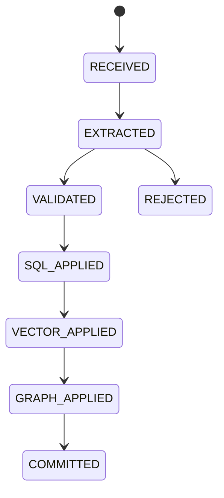

# Concepts and ingestion lifecycle

## Identity and scope

| Concept | Implemented meaning |
|---|---|
| Principal | Server-authenticated identity owning keys and ACL grants |
| Tenant | V4 authorization boundary |
| Workspace | Tenant-owned grouping of datasets |
| Dataset | Source collection inside a workspace; session-bound access |
| Agent | Compute/persona context; not a tenant credential |
| Session | Server-generated principal/scope binding with immutable dataset set |
| Document | Dataset-owned source identity with a current revision head |
| Revision | Immutable source version with a frozen chunk manifest |
| Source chunk | Exact source content, ordinal, source reference and content hash |
| Assertion | Canonical subject/predicate/entity-or-literal fact with source evidence |
| Mutation | Durable admitted work and its state, separate from pipeline aggregate |
| Projection | Derived SQL/vector/graph artifact work with fenced claim and receipt |
| Evidence | Linked assertion/chunk/source span; not independently verified truth |

Catalog public IDs resolve inside the tenant. Physical storage keys are opaque;
passing a physical key as an external ID does not grant access. Agent and dataset
authorization are resolved from the session, never caller metadata.

## Admission and completion

`POST /v4/memory/insert` requires session, dataset, document, revision, chunk,
`title`, `source_ref` and exact `content`. See [API](api-reference.md) for bounds.
Admission returns `202` with candidate, mutation, pipeline-run and raw-log IDs.
This is durable admission, not visibility in every store.

The pipeline aggregate uses `QUEUED → RUNNING → EXTRACTED → VALIDATED →
PROJECTING → COMMITTED`. Technical recovery states include retry, dead-letter,
rollback and blocked cleanup. The SDK terminal set is `COMMITTED`, `REJECTED`,
`DEAD_LETTER`, `ROLLED_BACK`, `BLOCKED`; check status, not just method name.
Internal outbox/pipeline records may use `DLQ`; inspect each object's state.

Canonical `FactExtractionService` preserves zero-to-many extracted facts.
Validation mode 0 checks deterministically, mode 1 uses validator A, and mode 2
requires distinct A/B provider-model pairs. The runtime-selected policy is
snapshotted into admitted work; reserved `_mesa_*` metadata cannot downgrade it.
Rejected work may retain audit source but creates no active retrieval artifact.

Projection order is SQL → vector → graph. Separate stores do not share an ACID
transaction: fenced leases, receipts, ownership and reconciliation provide
idempotent convergence. A lost lease cannot finalize another owner's work.
Backpressure yields explicit admission errors; do not retry without bounds.

## Revision finalization and retries

For a multi-chunk revision set `finalize_revision=false` on all but the final
insert, with distinct chunk IDs and ordinals. The last insert freezes the
manifest. No new chunks may then enter that revision; the revision activates
only after every required child mutation succeeds. One document has one active
head. Create a new revision to change source content.

Use an insert `idempotency_key` (body field, <=128 characters) with the exact
same payload on retries. Conflicting payloads are rejected. Rebuild uses the
separate `Idempotency-Key` HTTP header. The SDK avoids unsafe automatic POST
retry after ambiguous failures; application recovery must inspect durable IDs.

`declared_content_hash` is the caller's whole-revision hash, `manifest_hash`
identifies frozen chunk membership, and a chunk `content_hash` identifies only
that chunk. Direct insertion does not establish a whole-revision hash.

## Correction, purge and rollback

Supersession retains historical assertions. A time-qualified query can include
eligible superseded evidence; an unqualified query uses active evidence.
Rollback removes source ownership; shared artifacts remain while another active
source owns them. Tombstones precede secondary cleanup; failure stays `BLOCKED`.
Purge requires dataset `OWNER` plus explicit `PURGE`; replay/rollback require
the originating scope and explicit `ROLLBACK`. Semantic rejection cannot be
reopened through generic replay (`409 NON_REPLAYABLE`). Non-head historical
rollback is a conflict. Do not edit store rows or leases manually.

## Producer contract

Core consumes exact content and identity; [MESA_Data](ecosystem.md) owns source
acquisition, chunking and verified source metadata. HTTP insertion supports a
typed `legal_identity`; the current SDK `insert` signature does not expose it.
Use the HTTP contract for that field. Bare “MADDE 1” text is insufficient to
prove law identity. Producer metadata accuracy remains an external responsibility.

Canonical V4 insertion requires the model-enabled combined processing consumer.
Model-disabled boot is topology/compatibility smoke and rejects V4 writes with
`503 canonical_processing_unavailable`; it is not a V4 insert/search demonstration.
